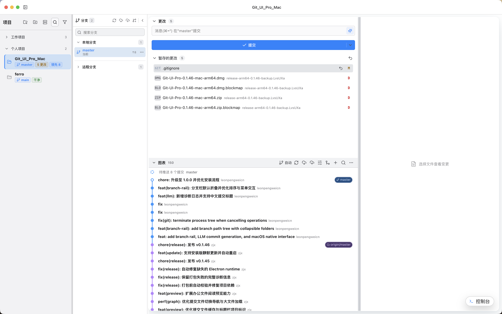
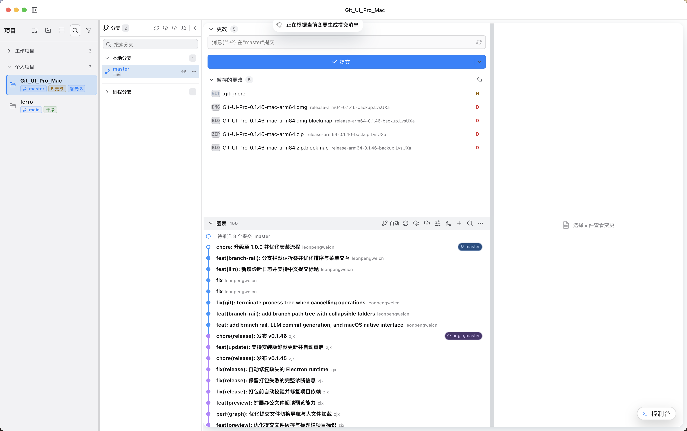
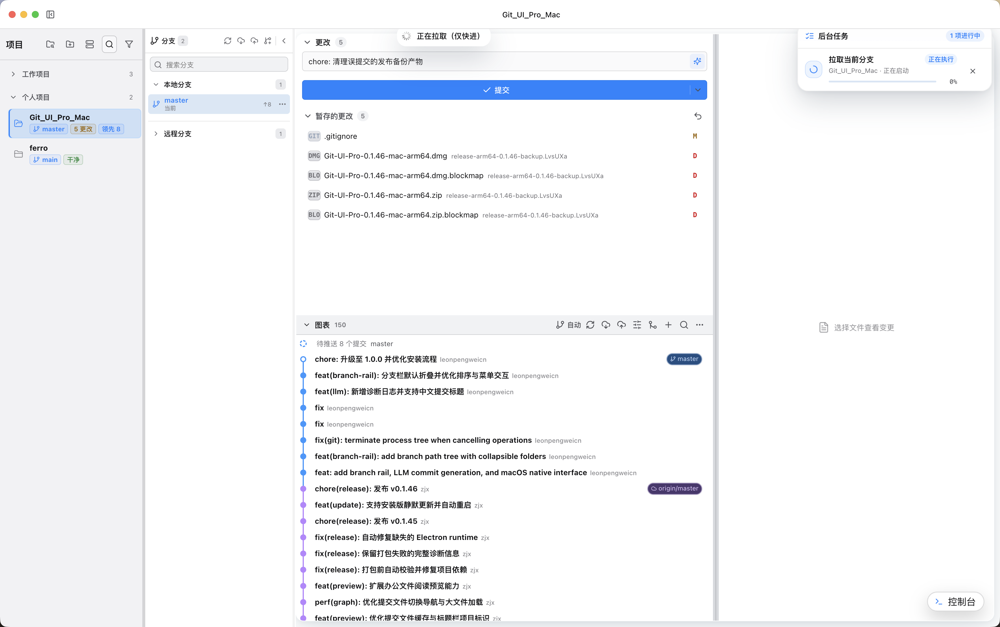

# Git UI Pro for macOS

面向 macOS 的中文 Git 桌面客户端，提供项目管理、分支操作、提交图、文件差异和常用 Git 工作流。

## 致谢

本项目基于 [zjx150504-lgtm/Git_UI_Pro](https://github.com/zjx150504-lgtm/Git_UI_Pro) 开发。

感谢原作者完成 Git UI Pro 的产品设计、核心功能和开源工作。本版本在原项目基础上适配 macOS，并继续扩展分支管理和 LLM 辅助提交能力。

## 本版本新增功能

### macOS arm64 适配

- 将原有 Windows 版本适配为 macOS arm64 版本。
- 使用 macOS 原生窗口交通灯、系统菜单和应用图标。
- 增加 macOS 环境校验、DMG/ZIP 打包、产物验证和界面 smoke test。
- 支持签名后安装到 `/Applications/Git UI Pro.app`。

当前 macOS 构建仅支持 Apple Silicon arm64，不支持跨架构构建。

### 主界面分支窗口

- 在主界面增加独立分支窗口。
- 分开展示本地分支和远程分支。
- 支持搜索、折叠多级分支路径和查看当前分支状态。
- 保留切换、拉取、推送、合并、变基和分支管理入口。

### LLM 生成 Git Commit Message

- 根据暂存区或工作区变更生成提交信息。
- 默认生成 `type(scope): 中文摘要` 格式的 Conventional Commit 标题。
- 支持配置 OpenAI 兼容接口、模型和 API Key。
- 使用系统安全存储保护 API Key，诊断日志不记录凭据和代码内容。

## macOS 界面截图

### 主界面与分支窗口



### LLM 生成提交信息



### 后台 Git 任务



## 环境要求

- Apple Silicon Mac，运行 macOS arm64。
- Node.js 20 或更高版本。
- npm，与仓库中的 `package-lock.json` 配套使用。
- Git 2.x，且 `git` 命令已加入 `PATH`。
- 安装正式应用时，需要有效的 macOS codesigning identity。

## 开发运行

安装锁定版本的依赖：

```bash
npm ci
```

启动 Vite、Electron TypeScript 监听和桌面应用：

```bash
npm run dev
```

仅启动浏览器渲染界面：

```bash
npm run dev:web
```

浏览器地址为 <http://127.0.0.1:5173>。浏览器模式使用模拟数据，不执行真实桌面 Git 操作。

## 编译与检查

执行 TypeScript 严格检查：

```bash
npm run typecheck
```

编译 Electron 主进程和 Vite 渲染进程：

```bash
npm run build
```

运行完整 Node 测试：

```bash
npm test
```

运行 Playwright 界面测试：

```bash
npm run test:ui
```

## 构建 macOS 安装包

先确认当前主机和 Node 运行时都是 arm64：

```bash
npm run verify:macos
```

生成 macOS arm64 DMG 和 ZIP：

```bash
npm run dist:mac -- --publish never
```

默认产物写入 `release/`。构建命令不会自动发布文件。

运行构建、产物校验和原生界面 smoke test：

```bash
make macos-arm64
```

该命令使用隔离的临时输出目录，并在完成后打印产物路径。

## 安装到 Applications

查看本机可用的代码签名身份：

```bash
security find-identity -v -p codesigning
```

使用钥匙串中的第一个有效身份完成构建、签名和安装：

```bash
make install
```

需要指定签名身份时：

```bash
MAC_SIGN_IDENTITY="Apple Development: Your Name (TEAMID)" make install
```

安装目标为 `/Applications/Git UI Pro.app`。脚本会先验证签名，再替换现有应用。

## 常用命令

| 命令 | 用途 |
| --- | --- |
| `make help` | 查看 Makefile 提供的全部入口 |
| `make install-deps` | 使用 `npm ci` 安装依赖 |
| `make dev` | 启动 Electron 开发模式 |
| `make build` | 编译主进程和渲染进程 |
| `make test` | 运行完整 Node 测试 |
| `make test-ui` | 运行 Playwright 界面测试 |
| `make dist-mac` | 生成 macOS arm64 DMG 和 ZIP |
| `make macos-arm64` | 构建、验证并 smoke-test macOS 包 |
| `make install` | 签名并安装应用到 `/Applications` |

更多打包与发布细节见 [docs/PACKAGING.md](docs/PACKAGING.md)。

## 隐私

Git UI Pro 只操作用户主动添加的仓库。远程操作遵循仓库现有的 Git remote 配置。

详细说明见 [docs/PRIVACY.md](docs/PRIVACY.md)。

## 贡献

提交代码前，请运行类型检查和相关测试。贡献说明见 [CONTRIBUTING.md](CONTRIBUTING.md)。

## 许可证

本项目沿用原项目的 [MIT License](LICENSE)。
